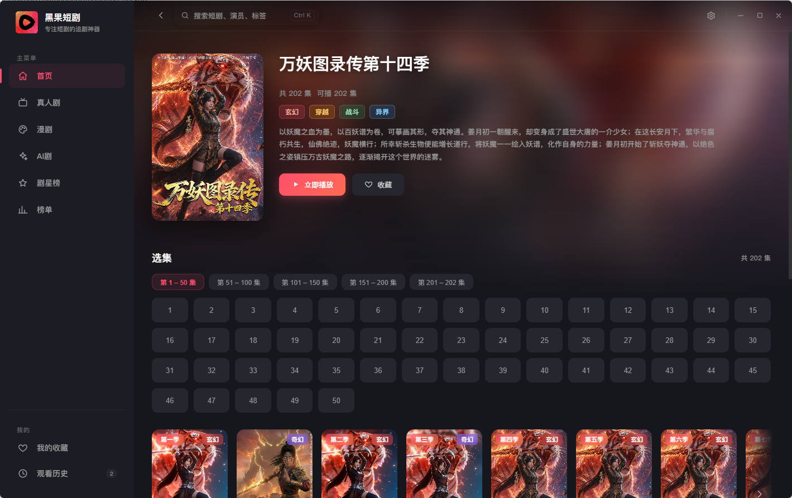
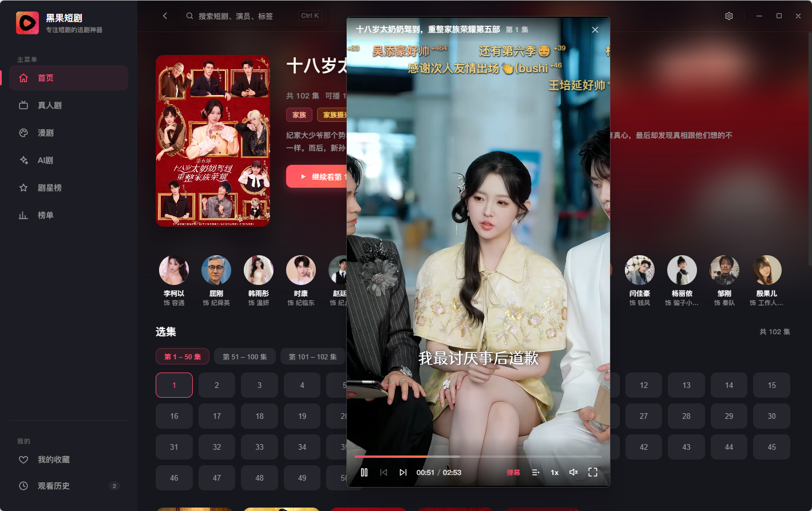
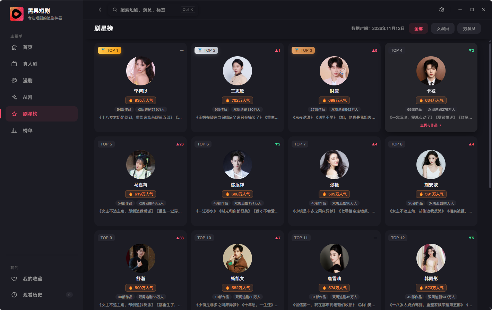

# 红果短剧桌面版

基于 **Electron 35 + React 18** 的红果短剧（hongguoduanju.com）第三方桌面客户端。

> 免责声明：本项目仅供学习研究，所有数据均来自目标站点公开接口，不缓存、不转存、不二次分发任何视频内容；视频流直连原站点 CDN，版权归原作者及平台所有，请勿用于商业用途。

## 界面预览

| 首页 | 详情页 |
| --- | --- |
|  |  |

| 播放页（独立沉浸式播放器） | 星榜 |
| --- | --- |
|  |  |

## 项目优点

- **协议层直连，稳定不依赖网页改版**：不走网页爬虫，直接对接 App 协议层（含完整请求签名与设备风控），配合官网数据源组成**双源降级**——任一源失效自动切换，播放地址解析失败自动重试与恢复。
- **智能推荐**：本地画像引擎（观看完成度、收藏、近期历史的半衰期加权）驱动分类轮转 Feed，带探索槽与跨会话冷却，越用越准、纯本地计算不上传任何数据。
- **独立沉浸式播放器**：播放器运行在独立无边框窗口，支持窗口比例贴合视频（16:9 / 竖屏自适应）、倍速、连播、自动跳过片头进度记忆。
- **弹幕**：弹幕开关/行数/速度/字号偏好与主窗口同源持久化。
- **全量本地持久化**：收藏、观看历史（精确到集与进度）、搜索历史、设置均存本地，无账号也能完整使用。
- **原生级桌面体验**：无边框窗口 + 自定义标题栏、系统托盘、开机自启动、关闭最小化到托盘、暗色主题。

## 功能一览

浏览（首页分区 / 分类 / 四大榜单）、搜索（联想 + 分页结果）、详情页（简介 / 演员表 / 相关推荐 / 热评）、播放（hls.js 直链播放 / 选集 / 下一集）、演员榜单与星榜、演员主页、收藏与历史管理、登录态维护、智能推荐（首页「为你推荐」+「猜你喜欢」）。

## 使用方法

环境要求：Node.js 18+（开发）。

- **Windows 10 / 11**：官方提供安装包（NSIS + 便携版，x64），已验证。
- **macOS / Linux**：代码基于 Electron 跨平台实现（含 ffmpeg 调用的平台适配），从源码运行理论可用，但官方不提供安装包，也未经测试验证，欢迎自行构建反馈。

```bash
# 安装依赖（Windows 下如 electron 二进制未自动下载，执行 node node_modules/electron/install.js）
npm install

# 开发模式（热更新）
npm run dev

# 构建（产物在 out/）
npm run build

# 打包 Windows 安装包（NSIS + portable，输出在 release/）
npm run dist
```

## 项目结构

```text
├── src/
│   ├── main/             # 主进程：窗口管理、IPC、托盘、登录态
│   ├── preload/          # contextBridge 白名单 API（window.hongguo）
│   ├── renderer/         # React 18 界面（自定义暗色主题）
│   │   └── src/recommend-engine/  # 本地智能推荐引擎（画像/打分/Feed）
│   └── server/           # 协议层：App 协议请求签名、风控设备管理、
│                         #   官网双源降级、视频直链解密与本地流端点
├── resources/            # 应用图标
└── .img/                 # README 界面截图
```

技术栈：Electron 35、React 18、React Router、Zustand、hls.js、axios、cheerio、TypeScript。

## 致谢

本项目的接口协议分析与实现思路参考了开源项目 [zfdang/hongguo-open-player](https://github.com/zfdang/hongguo-open-player)，感谢原作者的出色工作。

## 开源协议

[AGPL-3.0](https://www.gnu.org/licenses/agpl-3.0.txt)（与参考项目 [hongguo-open-player](https://github.com/zfdang/hongguo-open-player) 一致）
